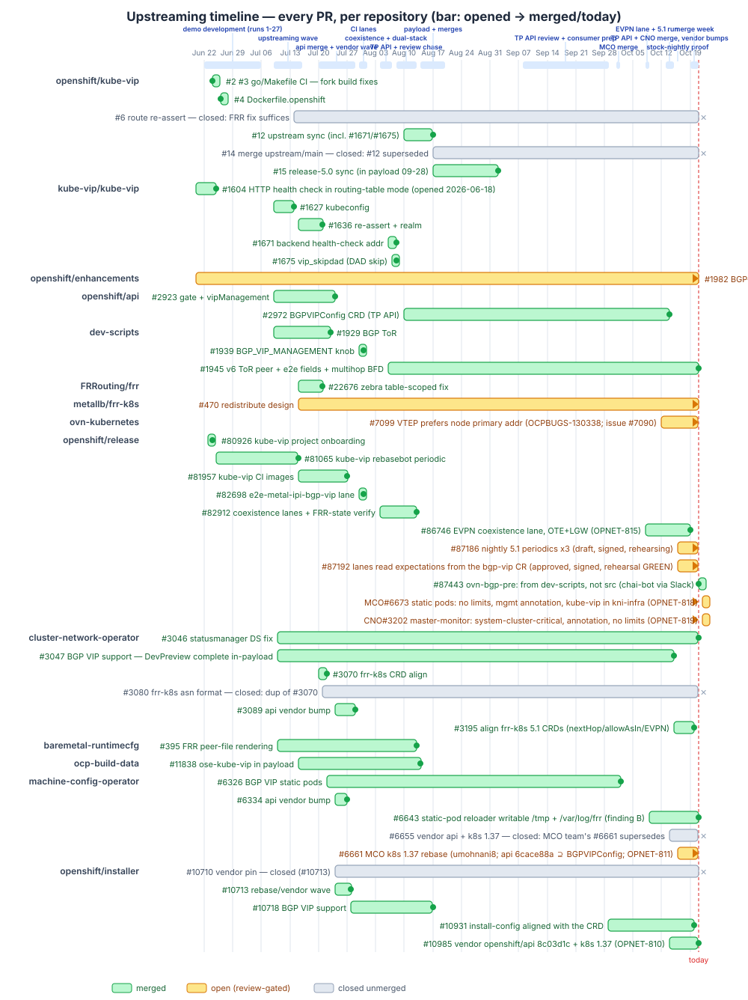
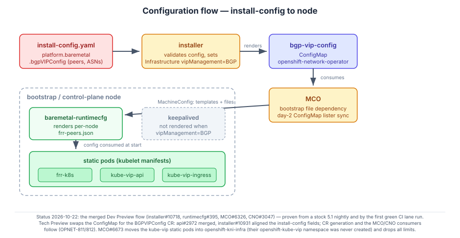
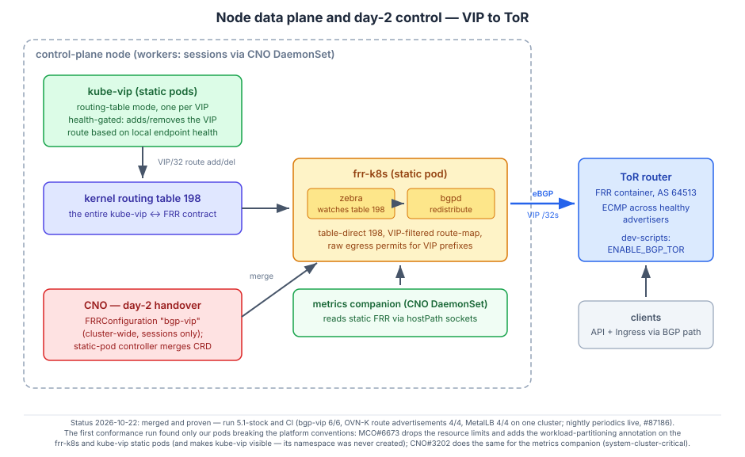
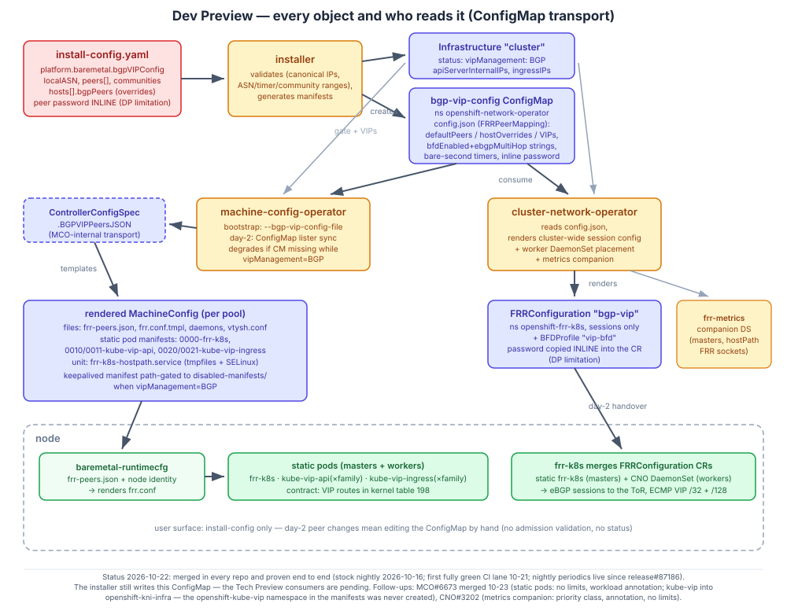
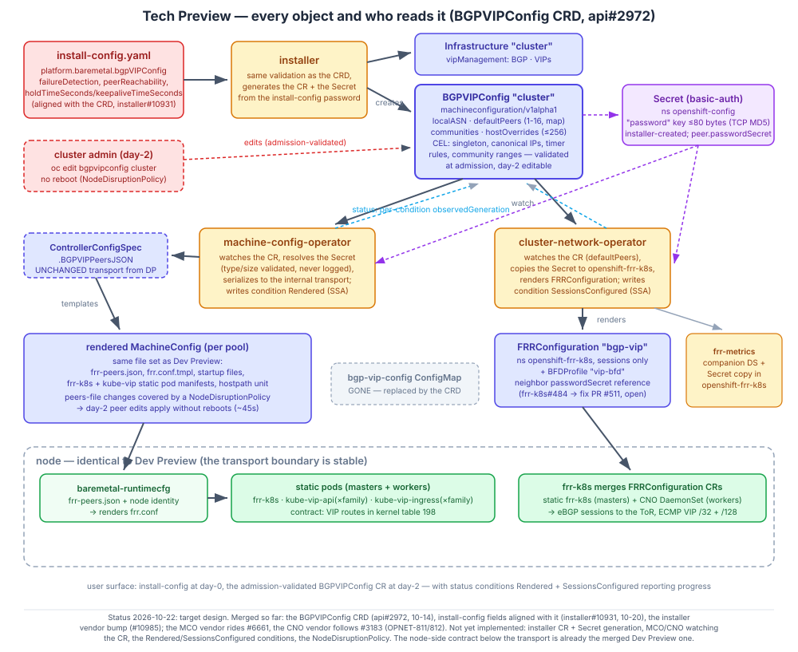

# BGP VIP Management — Dev Demo Workspace

Working demo and upstreaming workspace of
[openshift/enhancements#1982](https://github.com/openshift/enhancements/pull/1982)
(OPNET-595/OPNET-773): BGP-based VIP management for on-premise OpenShift —
kube-vip (routing-table mode) + frr-k8s static pods replacing keepalived.

**Status (2026-10-30): DevPreview is merged in every repo, the TP `BGPVIPConfig` API (api#2972) and its payload CRD (api#3127, finding K) too, the CI lanes and their fixes (release#87192/#87522), the **nightly 5.1 periodics (release#87186; `bgp-vip` green on all eight runs since it went live)**, the platform-pod-convention fixes (**MCO#6673, OPNET-818** and **CNO#3202, OPNET-819**), the CRD guard in the lane (**release#87762**, 10-28) and the frr-k8s webhook fix (**metallb/frr-k8s#511**, 10-28). **Tech Preview consumer wave — four PRs open, all proven on day 0 (10-27), none reviewed by a human yet**: **installer#11026** (CR + Secrets alongside the ConfigMap; its own lane green), **MCO#6685 + #6686** (fixes + CR-only consumer; #6685 has emy's lgtm), **CNO#3206 + #3207** (chai-bot's api/client-go bump with Mat's lgtm + CR-only consumer); the ConfigMap path is being removed everywhere, no fallback, and the last step — **installer#11049**, drop the ConfigMap asset — is open as a held draft stacked on #11026 (merge only once both consumers are in an Accepted nightly). Payload healthy again: `5.1.0-0.nightly-2026-10-29-150612` Accepted; the `ovn-bgp-metallb` periodic has every BGP step green and the finding-I tests passing, its conformance red is payload-wide **plus finding L** (**OPNET-820**, filed 10-30: `API LBs follow /readyz` fails on BGP VIP clusters — local clients reach the local not-ready apiserver through the VIP during master boot; RUN-LEDGER findings ledger). Also open: ovn-k#7099 (finding C, parked), frr-k8s#470 and enhancements#1982 (awaiting reviewers). **The dev host metal-u15 is decommissioned 2026-10-31; nothing lives there that is not on GitHub.** Full handoff: docs/RUN-LEDGER.md 'HANDOFF STATE'.**
All six demo criteria proven across 27 install runs (see
[docs/demo-results.md](docs/demo-results.md), [docs/RUN-LEDGER.md](docs/RUN-LEDGER.md)):
API + Ingress VIPs advertised via BGP from bootstrap through steady state,
health-gated per node, CRD handover, failover, full metrics coverage,
console over the BGP-routed path — most recently on a cluster deployed with
the one-click dev-scripts knob and verified by the CI lane's acceptance
script.

Upstream state:

- **Merged — the DevPreview feature (every repo)**: openshift/api#2923
  (gate + `vipManagement` + `BGPVIPPeersJSON`), **installer#10718**
  (OPNET-781, 2026-08-17), baremetal-runtimecfg#395 (OPNET-785),
  **MCO#6326** (OPNET-782, 2026-10-02), **CNO#3047** (OPNET-783,
  2026-10-15 — FRRConfiguration rendering, frr-k8s DaemonSet control-plane
  avoidance, static-pod RBAC + metrics, peer port/timer contract),
  **ocp-build-data#11838** (OPNET-779; kube-vip in the payload since
  2026-08-20, dual-stack fixes since the 2026-09-28 nightly). Proven
  end to end from the stock nightly `5.1.0-0.nightly-2026-10-16-040146`
  with no custom images (RUN-LEDGER run 5.1-stock): bgp-vip 6/6, OVN-K
  route advertisements 4/4, MetalLB 4/4 on one cluster.
- **Merged — Tech Preview API + consumers (merge week 10-19 → 10-21)**:
  **openshift/api#2972** (2026-10-14, `BGPVIPConfig` CRD, OPNET-809);
  **installer#10931** (2026-10-20, install-config peer fields aligned with
  the CRD) + **installer#10985** (2026-10-21, openshift/api 8c03d1c42 +
  Kubernetes 1.37 vendor) — **OPNET-810 complete**; **CNO#3195**
  (2026-10-20, frr-k8s 5.1 CRD sync: nextHop/allowAsIn/EVPN);
  **CNO#3046** (2026-10-21, statusmanager: a DaemonSet matching zero nodes
  is not Progressing) — **OPNET-783 complete**; **dev-scripts#1945**
  (2026-10-21, v6 ToR peer + every optional peer field + multihop BFD,
  OPNET-815 finding A) — **OPNET-787 complete**; **MCO#6643** (2026-10-21,
  static-pod reloader writable `/tmp` + `/var/log/frr`, OPNET-815 finding
  B — without it masters never applied day-2 FRRConfigurations).
  OPNET-811 (MCO vendor) rides the MCO team's own 1.37 rebase **MCO#6661**
  (api 6cace88a ⊇ BGPVIPConfig; our #6655 closed as superseded).
- **Merged — CI**: openshift/release#81957 + #82698 (`e2e-metal-ipi-bgp-vip`)
  + #82912 (coexistence + dual-stack lanes + FRR runtime-state verify) +
  **#86746** (2026-10-19, EVPN coexistence lane, OPNET-815); dev-scripts
  #1929 + #1939; kube-vip onboarding #80926 + #81065; the vendor wave
  (MCO#6334, CNO#3089, installer#10713), CNO#3070; the full upstream
  kube-vip series (#1604, #1627, #1636, #1671, #1675) and downstream syncs
  #12 + #15; FRRouting/frr#22654 fixed upstream via #22676. **Not**
  fixed upstream: metallb/frr-k8s#484 (webhook rejects a shared neighbor
  that mixes `passwordSecret` and inline `password`) was auto-closed as
  stale on 2026-09-20 — our fix is **metallb/frr-k8s#511** (merged
  2026-10-28, see below; not in a frr-k8s release yet). Closed/superseded: installer#10710
  (by #10713), CNO#3080 (dup of #3070), kube-vip#6, kube-vip#14 (by #12),
  MCO#6655 (by #6661).
- **Merged — CI, continued (10-21/22)**: **release#87443** (chai-bot,
  10-21: shared step `baremetalds-e2e-ovn-bgp-pre` runs `from: dev-scripts`,
  unblocking the ovn-bgp workflows as periodics), **release#87192** (10-22,
  squash `ca63f202628d`: lanes derive their expectations from the
  CNO-rendered `bgp-vip` FRRConfiguration — metallb-pre mirrors
  password/multihop/timers onto the BGPPeer, bgp-vip-verify checks
  negotiated timers/BFD/families against the CR, datapath checks poll),
  **release#87186** (10-22, `18cba7966`: nightly 5.1 periodics for the
  three lanes).
- **Merged — 10-22 pm**: **release#87522** (`4dc801d2c`; the lanes'
  `lb-echo` test workload moves from `default/` to its own `bgp-vip-e2e`
  namespace — origin audits `default/` as a platform namespace, finding
  I; rehearsal acked, the first periodics on 10-23 are the proof run),
  **MCO#6661** (`19d25ab56`, the MCO team's k8s 1.37 rebase carrying api
  6cace88a ⊇ `BGPVIPConfig` — the OPNET-811 vendor prerequisite),
  **CNO#3183** (k8s 1.37 — the OPNET-812 prerequisite; CNO's api pin
  f8795cdde518 still predates api#2972, so an api-only bump comes next).
- **Merged — 10-23**: **MCO#6673** (`87976ea29`, OPNET-818 closed) —
  frr-k8s + kube-vip static pods drop resource limits, gain the
  workload-partitioning annotation, and kube-vip renders into
  `openshift-kni-infra` (finding J: nothing ever created
  `openshift-kube-vip`, so its mirror pods never existed). First nightly
  that can carry it: anything built after 10:34 UTC (10-23-094141 does
  not).
- **Merged — 10-26**: **CNO#3202** (`1f40d2069`, OPNET-819 closed) —
  `frr-k8s-master-monitor` gets `system-cluster-critical`, the
  annotation, no limits (the one required red, `e2e-aws-ovn-fdp-qe`, was
  the payload-wide IPSec FDP test 83672 flake, overridden).
- **Open**: **ovn-k#7099**
  (OCPBUGS-130338, finding C: VTEP picks the VIP) — draft, parked.
  **Merged 2026-10-28: metallb/frr-k8s#511** (`97c0d9349`, `fix/484-mixed-password-validation`):
  the validation webhook used an *empty* password for unresolved
  `passwordSecret` references, so a neighbor shared by a secret-backed
  FRRConfiguration (ours) and an inline-password one (MetalLB) was
  rejected even when the passwords match — the reason CNO renders the
  resolved password inline today. The fix validates unresolved refs with
  a validation-only placeholder, keeps the known-password conflict
  checks, works on deep copies, and adds controller + webhook regression
  tests (both creation orders, updates, peer/VRF isolation, strict
  reconciliation). Not in a frr-k8s release yet (v0.0.27 predates it);
  once it ships in the frr-k8s image CNO deploys (`metallb-frr`, built
  from github.com/openshift/frr), flip CNO's `renderInlinePassword` so
  the FRRConfiguration carries the `passwordSecret` reference.
  metallb/frr-k8s#470 (redistribution design) and
  openshift/enhancements#1982 await reviewers.

Full tracker: [docs/NEXT-STEPS.md](docs/NEXT-STEPS.md) (Jira subtask
mapping + PR tracker).

How the work landed over time — every PR across the twelve repositories,
from the June demo build-up through the July upstreaming and vendor waves
to the CI lane:

## Document map

| Doc | Purpose |
|-----|---------|
| [docs/demo-results.md](docs/demo-results.md) | Acceptance evidence + EP-relevant design findings |
| [docs/PATCHES.md](docs/PATCHES.md) | Every commit in every repo, with rationale; payload recipe; branch-state addendum |
| [docs/RUN-LEDGER.md](docs/RUN-LEDGER.md) | All 27 install runs + lab sessions + CI runs: what failed, what fixed it |
| [docs/RUNBOOK.md](docs/RUNBOOK.md) | Operational how-to: rebuild images, assemble payload, deploy, verify, debug; FRR provenance; kube-vip↔FRR positioning |
| [docs/NEXT-STEPS.md](docs/NEXT-STEPS.md) | Handoff: productization phases, PR tracker, EP corrections, upstreaming |
| [docs/compatibility-webhook-investigation.md](docs/compatibility-webhook-investigation.md) | Root-cause of the run24 cluster-wide CRD-write outage (networking, not the webhook) + filing guidance |
| [docs/kube-vip-art-onboarding.md](docs/kube-vip-art-onboarding.md) | ART payload-member onboarding for ose-kube-vip (OPNET-779) |
| [docs/frr-k8s-*.md](docs/) | frr-k8s feature request + redistribution design drafts (metallb/frr-k8s#469/#470) |
| [docs/superpowers/](docs/superpowers/) | Original design spec + 18-task implementation plan (historical) |

## Artifacts in this repo

| Path | What |
|------|------|
| `bgp-tor.sh`, `tor/` | FRR ToR container helper for the hypervisor (up/down/status); superseded in dev-scripts by `ENABLE_BGP_TOR` (#1929) |
| `patches/` | historical git-am-able patch series (CNO) from before CNO#3047 merged — everything in it is upstream now; kept for provenance, recoverable from git history |
| `build/` | Dockerfiles used for the demo image builds + FRR build script |
| `lab/` | Standalone FRR reproduction labs that isolated both zebra bugs without a cluster |

## The demo in two pictures

A single knob in install-config (`bgpVIPConfig`; `BGP_VIP_MANAGEMENT=true`
in dev-scripts) flows through the installer and MCO into per-node FRR peer
config and the three static pods, replacing keepalived:

On each node, kube-vip health-gates a VIP/32 route in kernel table 198;
frr-k8s redistributes that table into BGP toward the ToR. Day-2, CNO hands
over session config via a cluster-wide FRRConfiguration and runs the
metrics companion:

kube-vip and FRR never talk to each other — kernel table 198 is the entire
contract (see RUNBOOK "kube-vip↔FRR relationship"). FRR daemons come from
the FDP `frr10` RPM inside the `metallb-frr` image built from
github.com/openshift/frr (see RUNBOOK "FRR provenance").

## The API in two pictures — Dev Preview vs Tech Preview

Every object each phase creates (CRs, ConfigMaps, Secrets, MachineConfigs,
static pods) and who reads it. Dev Preview: the installer writes the
`bgp-vip-config` ConfigMap and both operators consume it — no admission
validation, no status, inline password:

Tech Preview (`BGPVIPConfig` CRD, openshift/api#2972 — merged 2026-10-14) is
the **target design**: the ConfigMap goes away — the installer generates the
admission-validated, day-2-editable CR plus a basic-auth Secret; the
operators watch the CR and report progress through status conditions.
Everything below the MCO-internal transport is byte-identical to Dev Preview
— the node-side contract never moves. As of 2026-10-30 the CRD ships in the
payload (api#3127) and the whole consumer wave is open and day-0 proven:
installer#11026 writes the CR + Secrets next to the ConfigMap, MCO#6686 and
CNO#3207 read only the CR, installer#11049 (held) removes the ConfigMap once
they are in a nightly:

## Where the code lives

Canonical carriers: **the open upstream PRs** (see tracker). Development
branches live in the migrated workspace on the demo host:
`root@metal-u15:/root/OPNET-595-BGP/git/github.com` (see `HANDOFF.md` there;
`/home/kmateusz/git/github.com` is symlinked for the dev-branch go.mod
replace paths).

| Repo | PR branch (canonical) | Dev/demo branch |
|---|---|---|
| openshift/api | merged (#2923) | `OPNET-595-bgp-vip-management` |
| installer | merged (#10718, #10931 install-config ↔ CRD, #10985 k8s 1.37); **open #11026** (`opnet-810-bgpvipconfig-cr`: CR + peer Secrets, day-0 proven) → **open #11049** (`opnet-810-drop-bgpvip-configmap`: drop the ConfigMap; held draft, stacked on #11026) | `OPNET-595-bgp-vip-management-vendored`; the Aug prototype `bgpvipconfig-crd` (1864ea3844) is superseded, kept on the fork |
| machine-config-operator | merged (#6326, #6643, #6661 vendor, #6673 pod conventions); **open #6685** (`opnet-811-bgp-vip-fixes`: peers-JSON merge + disable-connected-check; lgtm) → **open #6686** (`opnet-811-bgpvipconfig-consumer`: CR-only consumer, day-0 proven) | the Aug prototype `bgpvipconfig-crd` (56ab76d64) is superseded, kept on the fork |
| cluster-network-operator | merged (#3047, #3195, #3046, #3183 k8s 1.37, #3202 pod conventions); **open #3206** (chai-bot api/client-go bump; lgtm) → **open #3207** (`opnet-812-bgpvipconfig-consumer`: CR-only consumer, full-stack day-0 proven) | the Aug prototype `bgpvipconfig-crd` (a5680c393) is superseded, kept on the fork |
| baremetal-runtimecfg | merged (#395) | `OPNET-595-bgp-vip-management` |
| kube-vip | upstream #1604 #1627 #1636 #1671 #1675 merged; downstream #2/#3/#4/#12/#15 merged, #6/#14 closed | `OPNET-595-bgp-vip-management` |
| metallb/frr-k8s | open #470 (`redistribution-support`, design doc); **merged #511** (2026-10-28, `fix/484-mixed-password-validation`, mixed inline/secret passwords — not in a release yet) | — |
| dev-scripts | merged (#1929, #1939, #1945) | `/root/dev-scripts` on metal-u15: `bgp-5.1-run` (deploy config of the last cluster) — **host decommissioned 2026-10-31** |
| openshift/release | merged (#80926, #81065, #81957, #82698, #82912, #86746, #87443, #87192, #87186, #87522, **#87762** CRD guard) | fork is `mkowalski/openshift-release` (renamed from `mkowalski/release`; old URL redirects). The installer fork was renamed too: `mkowalski/openshift-installer` (old `mkowalski/installer` redirects) |

Images: the last cluster (run 5.1-stock, 2026-10-16 → host decommissioned
2026-10-31) was the **stock
nightly** `5.1.0-0.nightly-2026-10-16-040146` — no custom images, no fork
`replace`s; only the three masters' frr-k8s static pod manifest was
hot-patched with MCO#6643's diff (merged since). Previous 5.1 cycle
(5.1-evpn) used `quay.io/mkowalski/ocp-release:bgp-vip-5.1` (base
5.1.0-0.nightly-2026-10-06-091356 + CNO#3047+#3046 image).
Historical demo set: `quay.io/mkowalski/{machine-config-operator,cluster-network-operator,baremetal-runtimecfg,kube-vip,cluster-config-api,metallb-frr}:bgp-demo`,
payload `quay.io/mkowalski/ocp-release:bgp-vip-demo` (base
5.0.0-0.nightly-2026-07-20-081439).

Demo environment: `root@metal-u15` (dev-scripts at `/root/dev-scripts` with
the knob applied, demo config `config_root.sh`; ToR via `ENABLE_BGP_TOR`).

## CI

Three installer presubmits (optional, `/test …` or `/testwith`) and, since
release#87186 (2026-10-22), three nightly 5.1 periodics with the same step
bodies:

| Lane | Steps (after dev-scripts install with `BGP_VIP_MANAGEMENT=true`, `ENABLE_BGP_TOR=true`, v4v6, 3+2) | Periodic |
|---|---|---|
| `e2e-metal-ipi-bgp-vip-metallb` | `bgp-vip-verify` (6 checks: vipManagement=BGP, static pods / no keepalived, ToR sessions with negotiated timers + BFD + families **derived from the `bgp-vip` FRRConfiguration**, per-VIP path counts, console) → `metallb-pre` (MetalLB operator, BGPPeer mirroring the ToR peer, pool, `lb-echo` LoadBalancer) → `metallb-verify` (same-neighbor merge, LB IP advertised from every node, datapath over BGP on both families) | `bgp-vip`, daily 02:00 UTC |
| `e2e-metal-ipi-bgp-vip-ovn-bgp-metallb` | + `ovn-bgp-pre` (external FRR route reflector, OVN-K route advertisements) and `ovn-bgp-verify` (both FRRConfigurations merged, RR sessions, pod subnets, datapath) before MetalLB; the only lane that also runs `baremetalds-e2e-test` (conformance) | `ovn-bgp-metallb`, Mon/Wed/Fri |
| `e2e-metal-ipi-bgp-vip-ovn-bgp-evpn` (release#86746, OPNET-815) | ovn-bgp flow + local-gateway migration + the **ovn-kubernetes OTE suite** (43 EVPN tests against the same route reflector) + a verify step for the EVPN FRRConfiguration merged by the **static-pod frr-k8s** on a master, its `l2vpn evpn` session, and a BGP-VIP regression guard; IPv4 underlay only | `evpn`, Tue/Thu |

Proof so far: `bgp-vip-metallb` fully green on 10-21 (release#87192
rehearsal — first fully green CI run of a BGP VIP lane, RUN-LEDGER finding
H); `ovn-bgp-metallb` green on every BGP step the same day, red only in
conformance — 18 payload-wide failures plus **3 caused by our pods**
(finding I → MCO#6673, CNO#3202, release#87522). **Periodics: `bgp-vip` green on every run so far (10-23 → 10-28, 6/6)** — first:
[`bgp-vip` SUCCESS](https://prow.ci.openshift.org/view/gs/test-platform-results-public/logs/periodic-ci-openshift-release-main-nightly-5.1-e2e-metal-ipi-bgp-vip/2113450686661267456) on its first
run; [`ovn-bgp-metallb` FAILURE](https://prow.ci.openshift.org/view/gs/test-platform-results-public/logs/periodic-ci-openshift-release-main-nightly-5.1-e2e-metal-ipi-bgp-vip-ovn-bgp-metallb/2113450690868154368) at `ovn-bgp-verify` [2/4] — the
masters never establish their route-reflector sessions because the
nightly (10-21-040310) predates MCO#6643 (finding B, reloader
`Read-only file system` ×119 on master-0).** Same result on
[10-26](https://prow.ci.openshift.org/view/gs/test-platform-results-public/logs/periodic-ci-openshift-release-main-nightly-5.1-e2e-metal-ipi-bgp-vip-ovn-bgp-metallb/2114537779533713408) while `nightly/latest` was stuck
on 10-21-040310 (every later nightly Rejected on the same blocking set,
ART not rebuilding operator images). **Cleared 10-27**: `5.1.0-0.nightly-2026-10-27-151641`
was Accepted with MCO#6643/#6673, CNO#3202 and api#3127 inside, and the
[10-28 run](https://prow.ci.openshift.org/view/gs/test-platform-results-public/logs/periodic-ci-openshift-release-main-nightly-5.1-e2e-metal-ipi-bgp-vip-ovn-bgp-metallb/2115262689100959744)
on it has **every BGP step green** (findings B and J gone, finding-I
tests passing in the payload); only `baremetalds-e2e-test` is still red,
on 13 payload-wide conformance failures with no BGP involvement. `evpn`
(Tue/Thu) stays red until ovn-k#7099.

